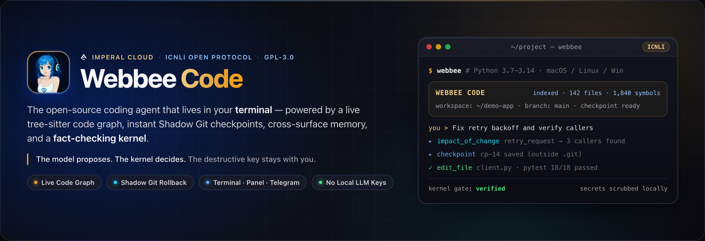
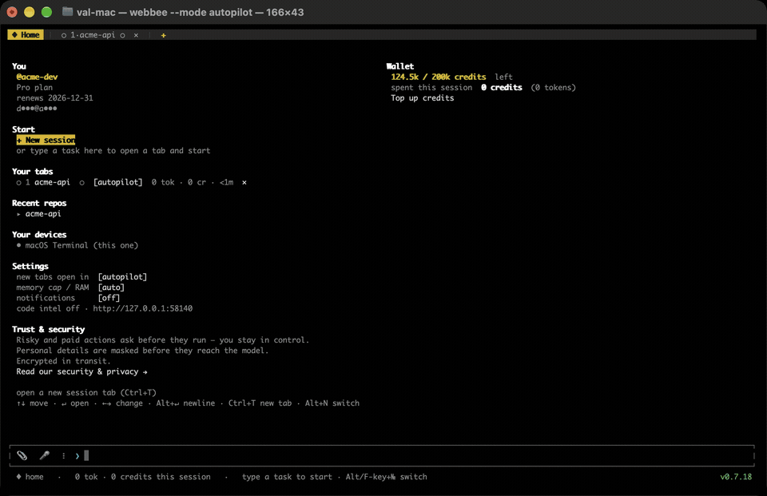
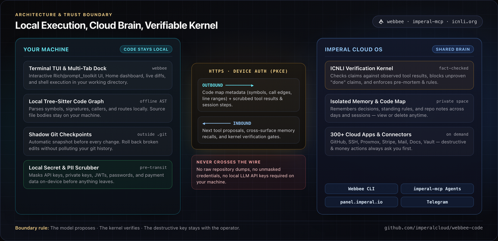

<p align="center">
  
</p>

<h1 align="center">Webbee 🐝 — The Open-Source ICNLI Coding Agent</h1>

<p align="center">
  <a href="https://pypi.org/project/webbee/"></a>
  <a href="https://pypi.org/project/webbee/"></a>
  <a href="LICENSE"></a>
  <a href="https://docs.imperal.io"></a>
  <a href="https://icnli.org"></a>
</p>

<p align="center">
  <strong>Python 3.7 – 3.14</strong> · <code>pipx install webbee</code> works on every one of them.
</p>

**Webbee** is the open-source terminal coding agent of [Imperal Cloud](https://imperal.io), powered by **[ICNLI](https://icnli.org)** (*Infrastructure Contextual Natural Language Interface*). It works directly in your local workspace (and over SSH): mapping your codebase with tree-sitter, checking blast radius before edits, isolating changes in worktrees or invisible Shadow Git checkpoints, verifying claims against real execution, and sharing one live memory across your terminal, IDE, web panel, and Telegram.

> **Open-Source Guarantee (GPLv3):** No locked silos, no hidden telemetry, no arbitrary execution barriers. The model proposes; the kernel verifies against real facts; **you hold the key**.

---

## 🎬 Live Terminal Demo

<p align="center">
  
</p>

*Recorded live in Terminal.app (`webbee v0.7.18`): Webbee opens an isolated worktree, reads `rate_limiter.py`, reproduces two failing tests with `pytest -q`, patches `TokenBucket.allow()` with an inline unified diff, and verifies `3 passed` with a Shadow Git checkpoint saved.*

---

## 📦 Installation

```sh
pipx install webbee
# or:  uv tool install webbee
# or:  pip install webbee        (inside a virtual environment)
```

Always the newest release: at its start `webbee` moves itself, `imperal-mcp`, and `imperal-sdk` onto their git repositories' `stable` branch (each release moves it to its tag) and records that branch, never a pinned version. From then on `pipx reinstall webbee`, `pipx upgrade --include-injected webbee`, and `uv tool upgrade webbee` all bring the newest release. Without `git` on the machine it stays on PyPI.

No Python tools at hand? One line installs [uv](https://docs.astral.sh/uv/) (which brings its own Python) and `webbee`:

```sh
curl -LsSf https://raw.githubusercontent.com/imperalcloud/webbee-code/main/install.sh | sh
```

Works with **any Python from 3.7**:

- **Python 3.10 or newer** — `webbee` runs directly on it.
- **Python 3.7 – 3.9** (macOS ships 3.9, Ubuntu 20.04 has 3.8) — the install is light, and the first `webbee` command sets up the same release on its own Python 3.12 once (about 30–45 s, needs internet; it fetches `uv` to do it). Every start after that is immediate, and it is the full `webbee` — code index included. It lives in `~/.local/share/webbee/runtime` and changes nothing else on your system.

<details>
<summary>Install troubleshooting</summary>

| You see | Why | Do |
|---------|-----|----|
| `Cannot install webbee==… because these package versions have conflicting dependencies` / `ResolutionImpossible` | a `webbee` release older than `0.5.6` on Python below 3.10 | `pipx install "webbee>=0.5.6"` (or `pip install -U webbee`) |
| `error: externally-managed-environment` | `pip install` into the system Python is blocked on Homebrew, Debian 12+, Ubuntu 23.04+ | `pipx install webbee` or `uv tool install webbee` |
| `webbee: command not found` after install | the tool folder is not on `PATH` | `pipx ensurepath` (or `uv tool update-shell`), then open a new terminal |
| `Could not set up webbee on Python 3.12` on the first start | Python 3.7–3.9 and no internet (or a proxy blocks `github.com` / `pypi.org`) | allow those hosts and start `webbee` again, or use the one-line installer above |
| `No matching distribution found for webbee` | Python 3.6 or older | use the one-line installer above — it brings its own Python |

</details>

---

## 🏗️ How Webbee Works

<p align="center">
  
</p>

Under **[ICNLI](https://icnli.org)**, local execution stays on your machine while the kernel tracks verified state, proofs, and cross-surface memory:

- **Live Code Map (Tree-sitter + Call Graph):** Ships with code intelligence by default (`orient`, `outline`, `read_symbol`, `graph_slice`, `contract_slice`, `impact_of_change`, `search_code`, `grep_code`). Reads the exact symbol instead of dumping whole files, and checks callers before editing shared code — locally or over SSH.
- **Shadow Git Time Machine & Isolated Worktrees:** Snapshots your workspace automatically before writes without touching your `.git` history. Inspect diffs or roll back any step via `/checkpoints`, `/rollback <ref>`, or the built-in checkpoint tools — or work in an isolated worktree so your main checkout stays clean.
- **Fact-Checked Execution & Proofs:** Plan items close only on observed proofs (verified diffs, passing command exits, grounded findings). Claims that do not match what was actually read or run are caught before delivery.
- **Autonomous Marathon & Headless Runs:** Run long-horizon autonomous tasks (`webbee --marathon "GOAL"`), single non-interactive turns for scripts/CI (`webbee --once "TASK"`), or interactive multi-tab coding sessions.
- **Multi-Tab Terminal Workspace & Queueing:** Open parallel workspace tabs (`/new`, `/tab`, `/tabs`, `/close`, `/rename`), queue follow-up messages while Webbee works (`/queue`), attach local files (`/attach`), inspect step details (`/steps`), and switch model tiers (`/model` or `Ctrl+B`).
- **One Brain Across Every Surface:** Shares your Imperal Cloud account, memory vault, and live sessions with **[imperal-mcp](https://github.com/imperalcloud/imperal-mcp)**, the [Imperal web panel](https://panel.imperal.io), and Telegram (`/notify [tg|panel|both|off]` mirrors a terminal session and lets you steer it remotely).
- **Native Vision, Web Research & Extensions:** Inspect screenshots and diagrams (`view_image`), search the web and read docs (`web_search`, `read_url`), and use connected Imperal Cloud extensions directly from the terminal.

---

## 💡 Quick Start & CLI

```sh
# Sign in to your Imperal Cloud account (OAuth 2.0 Device Flow + PKCE)
webbee login

# Start the interactive terminal agent in your project workspace
webbee

# Start in a specific mode (default | plan | autopilot)
webbee --mode autopilot

# Launch an autonomous marathon toward a goal
webbee --marathon "Add pagination tests and fix failing assertions"

# Run a single headless turn and exit (0 if answered, 1 otherwise)
webbee --once "Summarize the authentication flow in src/"

# Check version or log out
webbee --version
webbee logout
```

### Interactive Slash Commands & Shortcuts

Type `/help` inside Webbee for the full list:

- **Session & Auth:** `/login`, `/logout`, `/status`, `/cost` (`/usage`), `/sessions`, `/logout-others`, `/clear`, `/exit`
- **Modes & Model Tiers:** `/mode [default|plan|autopilot]` (`Shift+TAB` cycles modes), `/model [webbeesmart|supersmart|ultrasmart]` (`Ctrl+B` cycles tiers)
- **Tabs & Queue:** `/new [path]` (`Ctrl+T`), `/tab N` (`Alt+N`), `/tabs`, `/close` (`Ctrl+W`), `/rename <name>`, `/queue [clear]`, `/attach <path>`, `/steps [N]`
- **Reversibility & Steering:** `/checkpoints`, `/rollback <ref>`, `/notify [tg|panel|both|off]`

---

## 🛠️ Built-in Terminal Toolset

| Category | Tools | What they do |
|:---|:---|:---|
| **Code Intelligence** | `orient`, `repo_profile`, `outline`, `read_symbol`, `search_code`, `grep_code`, `graph_slice`, `contract_slice`, `impact_of_change` | Navigate repos by symbol graph, locate exact definitions, trace API contracts and blast radius before editing |
| **Files & Edits** | `read_file`, `write_file`, `append_file`, `edit_file`, `multi_edit`, `list_dir`, `glob` | Byte-exact file reading with paging, atomic edits, and workspace-confined directory listing |
| **Execution** | `shell` / `bash` | Run builds, tests, and terminal commands across macOS, Linux, and Windows |
| **Time Machine** | `checkpoint`, `checkpoint_diff`, `checkpoint_rollback` | Invisible Shadow Git snapshots, diffs, and instant rollbacks without touching `.git` |
| **Web & Vision** | `web_search`, `read_url`, `view_image` | Live web research, clean Markdown page reading, and native multimodal image inspection |

---

## 🔒 Security & Privacy

- **Approval gates:** Risky shell commands, destructive cloud tools, and rollbacks ask before running in `default` mode; billing/money actions require explicit approval in the Imperal panel.
- **PII masking:** Secrets, tokens, credentials in URLs, emails, phone numbers, card numbers, and SSNs are masked before reaching the model (and your email is masked on the terminal Home screen).
- **No password handling:** Sign-in uses OAuth 2.0 Device Authorization Grant (RFC 8628) + PKCE over HTTPS, stored locally in `~/.imperal/credentials.json` (`0600`).
- **Full details:** Read [PRIVACY.md](PRIVACY.md), [SECURITY.md](SECURITY.md), and [docs.imperal.io/en/guides/audit-and-security](https://docs.imperal.io/en/guides/audit-and-security/).

---

## 🦾 Using Claude Code, Cursor, Codex, or Gemini CLI?

If you already love your existing coding shell and want to add the same live code map, Shadow Git checkpoints, cross-surface memory, and fact-checked execution to it, install **[imperal-mcp](https://github.com/imperalcloud/imperal-mcp)** ([PyPI](https://pypi.org/project/imperal-mcp/)):

```sh
pipx install "imperal-mcp[code]" && imperal-mcp login && imperal-mcp setup
```

`webbee` and `imperal-mcp` share one Imperal Cloud account, memory vault, and live session state — start work in Claude Code or Cursor, and pick it up in Webbee, the web panel, or Telegram.

---

## 🤝 Contributing & License

Contributions, bug reports, and feature requests are welcome — use the [issue templates](.github/ISSUE_TEMPLATE/) or open a pull request.

Webbee is free and open-source software licensed under the **GNU General Public License v3.0 or later** (`GPL-3.0-or-later`). See [LICENSE](LICENSE) for details.

- **Homepage:** [imperal.io/webbee-code](https://imperal.io/webbee-code) · **Docs:** [docs.imperal.io](https://docs.imperal.io) · **Protocol:** [icnli.org](https://icnli.org) · **Privacy:** [PRIVACY.md](PRIVACY.md) · **Security:** [SECURITY.md](SECURITY.md)

Developed with 🐝 by the [Imperal Cloud](https://imperal.io) team.
